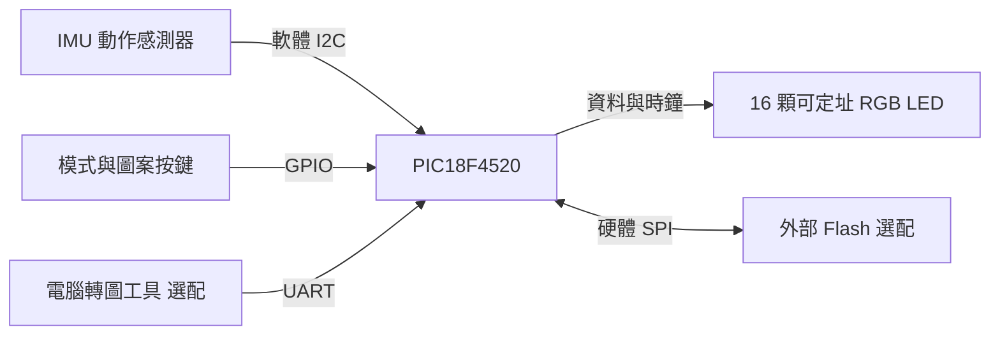

# 主題二｜PIC18F4520 智慧全彩 POV 光棒

> 專題規劃草案 · 五人小組 · PIC18F4520 為唯一主控制器。以下為預計實作內容，尚非成品或實測結果。

> 上圖用來說明外觀與使用情境。實際功能、階段及分工以本文件為準。

## 1. 專題動機與使用方式

一般應援光棒只能變色，本專題希望讓使用者揮動光棒時，在空中看見**彩色像素角色、Logo 和簡單動畫**。它可用於社團應援、活動表演與嵌入式系統展示。操作方式是按鍵選擇圖案或動畫，依提示方向揮動，讓光棒在有效行程中完成一張畫面。

| 功能 | 第一版／後續目標 |
|---|---|
| 彩色圖片 | 16 顆 RGB LED 顯示高 16 × 寬 32 的像素圖，先做 2～3 張容易辨識的角色、圖示或 Logo |
| 簡單動畫 | 先做一組 3～4 影格，例如角色揮手。每次有效揮動前進一格，回程不換格 |
| 揮動偵測 | 初版只在一個方向點亮，回程熄燈。穩定後再做反向逆序輸出與速度補償 |
| 操作介面 | 兩顆按鍵。切換圖案／動畫與切換模式 |
| 進階擴充 | 外部 SPI Flash、UART 自訂圖片上傳、寬 64 欄、電池低電量提示。完成基本版後再加入 |

## 2. 顯示原理與系統架構

光棒上只有一排 LED。PIC 把圖片切成垂直欄，按時間順序輸出。光棒移動時，每一欄的光出現在不同空間位置，視覺上合成一張圖。以高 16 × 寬 32 為例，16 顆 LED 決定高度，單次揮動依序輸出 32 欄。IMU 負責辨識揮動事件與估測週期，不直接提供精確的空間座標。

- **初版時序**：設定有效方向與觸發條件。Timer 到達下一欄時間就更新 LED。靠近終點或超時後熄燈，在下一次有效揮動前不重複觸發。
- **速度補償**：量測最近幾次有效行程的時間，用代表值估算下一次的欄間隔。它可以減少整張圖被拉長或壓縮，但不能完全修正單次揮動中忽快忽慢造成的局部變形。
- **通訊分配**：初版即可用硬體 SPI 驅動燈條。若加入 W25Q32，規劃由硬體 SPI 驅動 Flash，燈條移到另一組 GPIO 用軟體送時鐘與資料。燈條沒有一般 SPI 裝置的 CS，避免直接共用時鐘而被 Flash 傳輸干擾。若改用軟體輸出，先量測送完一欄所需時間。

## 3. 設備與取得方式

| 器材 | 數量 | 取得方式／查找關鍵字 |
|---|---:|---|
| PIC18F4520 實驗板或晶片與燒錄器 | 1 組 | 優先借用課程設備，先確認實驗板剩餘腳位 |
| 5 V 可定址 RGB LED 燈條 | 1 段，先用 16 顆 | 搜尋 `APA102`、`SK9822`、`144 LED/m`，核對是 Data + Clock、可獨立控色且可裁切 |
| 動作感測器模組 | 1 | 搜尋 `MPU6050 GY-521` 或同類 IMU，核對模組電源與訊號電壓 |
| 按鍵、測試板與配線 | 2 顆、1 組 | 校內實驗室或電子材料行 |
| 穩壓電源與電平轉換 | 1 組 | 先用桌上穩壓電源，量測亮度與電流後再決定可攜電源 |
| 外部 SPI Flash | 1（進階） | 搜尋 `W25Q32 SPI Flash 模組`，確認是否有電平轉換 |
| USB 轉 UART | 1（進階） | 校內借用或搜尋 `USB to TTL UART`，核對訊號電壓 |
| 握把、固定件與外殼 | 1 組 | 校內 3D 列印或手作，桌測成功後再製作 |

採購表先記錄數量與規格。實際單價、庫存與運費由小組詢價後補入。PIC 與燈條可共地，3.3 V 周邊與 5 V 訊號之間須依所選模組規格設計轉換，不要把「模組可接 5 V 電源」當成「訊號腳也耐 5 V」。燈條由適當的電源供電，不由 PIC 的 GPIO 供電。

## 4. 圖片、動畫與外部記憶體

PIC18F4520 有 32 KB 程式 Flash、1,536 bytes 資料 RAM。一張高 16 × 寬 32 的 RGB565 圖片需要 **1,024 bytes**。基本版可將常用圖片及幾個動畫影格存為程式 Flash 常數表，播放時一次只讀取一欄（**32 bytes**），不把整張圖搬進 RAM。

| 組合 | RGB565 素材容量（不含索引等額外資料） |
|---|---:|
| 高 16 × 寬 32，1 張 | 1 KiB |
| 高 16 × 寬 32，4 影格 | 4 KiB |
| 高 16 × 寬 64，4 影格 | 8 KiB |

若要存很多素材或讓使用者自行更新，使用 **W25Q32 SPI Flash（4 MiB）**。它增加的是**素材儲存空間**，不會增加 PIC 的 RAM。建議把圖片轉成「欄優先」格式，讓同一欄的 16 個像素在 Flash 中連續排列。讀出一欄，再轉成燈條所需的色彩資料。

進階上傳流程為電腦縮圖 → 轉成 RGB565 欄優先資料 → UART 傳給 PIC → PIC 寫入 Flash 並核對資料 → 光棒端選擇圖片。寫入只在上傳模式進行，避免與即時顯示同時搶資源。

## 5. 開發流程與驗收

| 階段 | 開發項目 | 驗收成果 |
|---|---|---|
| 1. 單元測試 | 控燈與感測分開做 | 16 顆 LED 可各自變色。IMU 讀值可觀察並區分靜止與揮動 |
| 2. 逐欄顯示 | Timer 排程、RGB565 解碼、內建圖案 | 在受控揮動下，以相機拍到不缺欄且方向正確的像素圖 |
| 3. 手持整合 | 有效行程偵測、回程熄燈、按鍵切換 | 重複揮動仍能辨識圖案，靜止或回程不誤播放 |
| 4. 動畫播放 | 影格索引與循環 | 連續有效揮動可依序看見同一角色的不同動作 |
| 5. 功能擴充 | 視進度做 Flash、UART 或速度補償 | 能展示其中一項從輸入到畫面改善的完整效果 |
| 6. 成品與繳交 | 握把、供電、文件與 Demo | 完成操作影片、可編譯程式、接線圖與測試紀錄 |

**Demo 建議**：先展示切換兩張圖，再展示角色揮手動畫。用長曝光照片輔助檢查缺欄與鏡像，另外保留正常拍攝的手持影片，分開說明相機長曝光與肉眼的觀看效果。

## 6. 五人分工

| 組員 | 角色 | 主要交付物 |
|---|---|---|
| A｜姓名待填 | 硬體一 | RGB LED、供電與握把。交付配線圖、耗電與亮度測試 |
| B｜姓名待填 | 硬體二 | IMU、按鍵、Flash 與電平轉換。交付周邊腳位表及模組測試 |
| C｜姓名待填 | 軟體一 | LED 驅動、Timer 排程、逐欄輸出與動畫。交付韌體模組與時序測試 |
| D｜姓名待填 | 軟體二 | 揮動判定、圖片轉檔、素材格式。視進度加入 UART 與 Flash 讀寫 |
| E｜姓名待填 | 軟硬體整合 | 定義模組介面、整合測試、重現畫面異常，統整接線、文件與 Demo。各組員提供自己負責的測試紀錄 |

## 7. 課程單元與繳交

- **基本版**：Timer 負責逐欄更新，Interrupt 以定時器中斷產生排程事件，硬體 SPI 可先用來傳送燈條資料。若整合外部 Flash，硬體 SPI 改用於 Flash 讀寫。中斷服務程式保持簡短，避免在其中等待 UART 或 Flash。
- **進階單元**：UART 上傳圖片、外部 SPI Flash、揮動週期估測、ADC 電池監測。可定址 LED 內部調光不算 PIC 自己實作 PWM。
- **應繳成果**：一頁提案、十頁內系統文件、程式碼壓縮檔與操作 Demo。系統文件記錄實際電路、模組介面、實測結果、遇到的問題和解法。

## 8. 放到 GitHub 或 HackMD

- **GitHub**：把本檔以 `README.md` 放在儲存庫根目錄，並一起上傳 `assets/pov-concept.png`，保留相對路徑。
- **HackMD**：把 Markdown 貼到新筆記，將概念圖上傳到筆記後，以 HackMD 產生的圖片網址取代 `assets/pov-concept.png`。

晶片原廠資料：[Microchip PIC18F4520 資料表](https://ww1.microchip.com/downloads/en/DeviceDoc/39631B.pdf)
